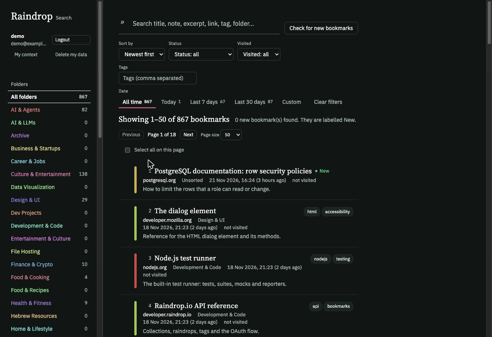

# Raindrop App

I built this web app to organize my Raindrop.io bookmarks with AI-assisted folders and tags.

It provides a single place to search, manage, and organize bookmarks, with support for multiple users and separate Raindrop accounts.

I use this product and I maintain it. I designed it, wrote the frontend and the backend, connected it to Raindrop and to a language model, and deployed it on my own server.

The screenshot is from the app in use. The bookmarks and the account in it are sample text.

## Key features

- **Search, filter and sort.** Search the title, the excerpt, the note, the link, the tags and the folder name. Filter by folder, tag, time and status. Sort by date, title, folder or number of visits.
- **AI suggestions for folders and tags.** Ask a language model for a folder and tags, for one bookmark or for a selection. Each suggestion comes with a reason. You review it before anything is saved.
- **Notes.** Add free text to a bookmark in the editor. The note is the note of the bookmark in Raindrop, so the Raindrop apps show the same text. The card shows it as plain text with its line breaks.
- **Bulk actions.** Move, tag, remove tags or archive many bookmarks in one action, with progress and cancel.
- **Duplicates.** Find links that point to the same page. Keep the most recent one and archive the others, or keep all of them.
- **Bookmarks that need work.** Find the bookmarks that have no folder, no tags, or neither.
- **Personal context ("My context").** Keep a list of your projects and interests. See "AI and personal context" below for its status.
- **One Raindrop account for each user.** Each user connects an account with OAuth and sees only their own data.
- **Control of your data.** Disconnect Raindrop at any time. "Delete my data" removes all that the app keeps about you. The bookmarks stay in Raindrop.

The full behavior of each element of the page is in [docs/ui-elements.md](docs/ui-elements.md).

### AI and personal context

There are three parts, and they do not have the same status.

1. **Folder and tag suggestions.** Available. The model gets the folder names, the known tags, and the title, the URL, the note, the current folder and tags, and the start of the excerpt of each bookmark.
2. **"My context".** Available. You add, edit and remove the entries yourself: projects, interests, and a short text about you. The app never writes an entry for you.
3. **The context in the suggestions.** In the code, not fully released. When you have active entries, they go to the model with each suggestion request, and the model can propose the tag of an entry. Such a tag is not selected at first: you select it, or it is not added. The measurement that must prove the precision of these tags has not passed yet, and one privacy decision is open. The status is in [docs/profile-plan.md](docs/profile-plan.md). A user with no entries gets the same suggestions as before.

An import of projects from GitHub is planned. It is not built.

## How it works

1. **Connect.** Approve the app in Raindrop (OAuth). The app stores the tokens encrypted.
2. **Browse and organize.** The app loads your bookmarks from Raindrop. Search and filter them, edit one bookmark, or select many.
3. **Ask for suggestions.** The app sends the selected bookmarks to the model and shows a suggestion for each one.
4. **Review.** Apply, edit or clear each suggestion. "Apply all" saves only the suggestions that need no decision. A bookmark that is already in a folder stays there unless you select the suggested folder. A new folder is created only when you select it.
5. **Save.** Each change that you apply goes to Raindrop. Nothing is saved before you apply or save it.

The app looks for new bookmarks when the page loads, and on request. During a session, a quick check shows how many bookmarks are new, and the list changes only when you ask.

## Getting started

### Requirements

- Node.js 22.13 or later. Tests pass on Node 22.23 and Node 26.
- PostgreSQL 17. Create the database `raindrop` with two roles: `raindrop_admin` (owns the database) and `raindrop_app` (the runtime role).
- A Raindrop app. Create it in the App Management Console. Note the Client ID and the Client Secret. Add the redirect URL (the default is `http://127.0.0.1:8100/oauth/callback`).
- An OpenAI-compatible endpoint, for the suggestions. This is optional. Without it, the other functions work.
- A sign-in header. The app has no sign-in page of its own (see below).

### Setup

1. Change to the backend folder: `cd app/backend`
2. Copy the example file: `cp .env.example .env`
3. Open `.env`. Enter the values. Git ignores the file.
4. Create the tables with the admin role: `npm run migrate`
5. Run the tests: `npm test`. Set `TEST_DATABASE_URL` and `TEST_DATABASE_ADMIN_URL` first, or the database tests are skipped.
6. Start the server: `npm start`
7. Open `http://127.0.0.1:8100` in a browser.

The app does not create tables when it starts. The runtime role has no rights to create them. Run `npm run migrate` again after each new migration file in `app/backend/migrations/`.

**Sign-in.** In production, a gateway signs the person in and sends the email in the `X-Admintools-Email` header. The app reads no other sign-in data. For a local run, add this header with your email to each request, for example with a local reverse proxy or a browser extension that sets request headers. Without the header, the page shows "Sign in required".

### Environment variables

| Variable | Purpose |
|----------|---------|
| `RAINDROP_CLIENT_ID` | Client ID of the Raindrop app. |
| `RAINDROP_CLIENT_SECRET` | Client Secret of the Raindrop app. |
| `RAINDROP_REDIRECT_URI` | Optional. The redirect URL. It must match the URL in the Raindrop app. |
| `API_Endpoint` | Optional. The base URL of the OpenAI-compatible endpoint, with its version path, for example `https://<host>/v1`. The app adds `/chat/completions`. |
| `token` | Optional. The token for the endpoint. |
| `llm_model` | Optional. The model name. |
| `PORT` | Optional. The port. The default is 8100. |
| `DATABASE_URL` | PostgreSQL connection string of the runtime role `raindrop_app`. |
| `DATABASE_ADMIN_URL` | PostgreSQL connection string of the admin role `raindrop_admin`. Used by `npm run migrate` only. |
| `DATA_DIR` | Optional. The folder for the encryption key. The default is `app/backend/data`. |
| `DATA_KEY_FILE` | Optional. The file with the encryption key. |
| `RAINDROP_ENV_FILE` | Optional. Another env file to read. |
| `BOOKMARK_STORE` | Optional. `on` or `off`. The default is `off`. With `on`, the app reads a copy of the bookmarks from PostgreSQL, and a full sync fills it. See `docs/bookmark-store-plan.md`. Do not turn it on in production before decision D6 is resolved. |

## Technology and architecture

- **Backend:** Node.js, with no framework. Its one npm package is `pg`.
- **Frontend:** plain HTML, CSS and JavaScript. The backend serves the files. The page makes no request to another site.
- **Database:** PostgreSQL, with one role for migrations and one role for the app.
- **Raindrop.io:** the REST API, with OAuth for each user.
- **Suggestions:** an OpenAI-compatible chat endpoint. You select the endpoint and the model.

The app runs as one process behind a reverse proxy. The modules and the rules of the data are in [docs/architecture.md](docs/architecture.md).

## Data and security

- Each user connects their own Raindrop account. Each query for user data is limited to the signed-in user.
- Raindrop is the source of truth. Each change goes to Raindrop first.
- The Raindrop tokens are stored encrypted (AES-256-GCM). The key is in a file with mode 600, apart from the database. Keep a backup of this file, separate from the database.
- The database holds the settings, the visits, the "New" labels, "My context", and a log of saved changes. The log keeps bookmark titles for 90 days. For a save that changes a note, it also keeps the note before and after the change.
- A copy of the bookmarks in PostgreSQL is built, behind the flag `BOOKMARK_STORE`. The flag is off by default. Without it, the bookmarks are in memory for 5 minutes. See [docs/bookmark-store-plan.md](docs/bookmark-store-plan.md) before you turn it on.
- A suggestion request sends bookmark data, and the active "My context" entries, to the model endpoint that you configure.
- "Disconnect Raindrop" removes the tokens and the stored copy, and keeps "My context". "Delete my data" removes all the rows of the user.
- The app trusts the sign-in header. It listens on `127.0.0.1` only, and the gateway must remove any `X-Admintools-*` header that a client sends.

These are the main rules, not the full list. The full list is in [docs/architecture.md](docs/architecture.md).

## Documentation

- [docs/ui-elements.md](docs/ui-elements.md): each UI element, its text, its rules and the accessibility requirements. The backend and the frontend follow this file.
- [docs/ui-samples/](docs/ui-samples/): the chosen design sample, `a-ledger.html`, with its sample data in `data.js`. Open it as a file in a browser. `BRIEF.md` describes the five samples that were built; the other four were removed after the choice. `FLOWS.md` lists every flow and how to reach it in the sample.
- [docs/architecture.md](docs/architecture.md): the modules, the design notes and the rules of the data.
- [docs/profile-plan.md](docs/profile-plan.md): the plan and the status of "My context" and its use in the suggestions.
- [docs/bookmark-store-plan.md](docs/bookmark-store-plan.md): the plan, the status and the rules of the stored copy of the bookmarks.

## Development and testing

Run `npm test` in `app/backend`. The tests use a fake Raindrop server. They do not call the real Raindrop API. The database tests need `TEST_DATABASE_URL` (role `raindrop_app`) and `TEST_DATABASE_ADMIN_URL` (a role that can create a schema). Each run creates its own schema and removes it at the end. Without the two variables, these tests skip.

`app/backend/scripts/live-api-check.mjs` is not part of `npm test`. It checks the real Raindrop API with a test account. Its comment lists the variables and the safety rules.

## Additional tool: CSV sync script

`sync.py` is a separate command-line script. It reads a CSV file and moves each bookmark to the folder in its row, with the suggested tags. I wrote it before the web app, to apply the folders and tags of a categorized CSV export.

It makes a dry run by default and changes nothing. It writes to Raindrop only with `--apply`. The instructions are in [docs/sync-script.md](docs/sync-script.md).
